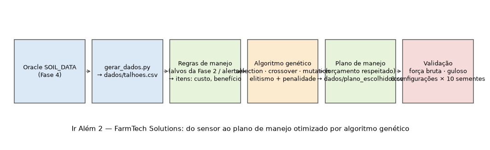
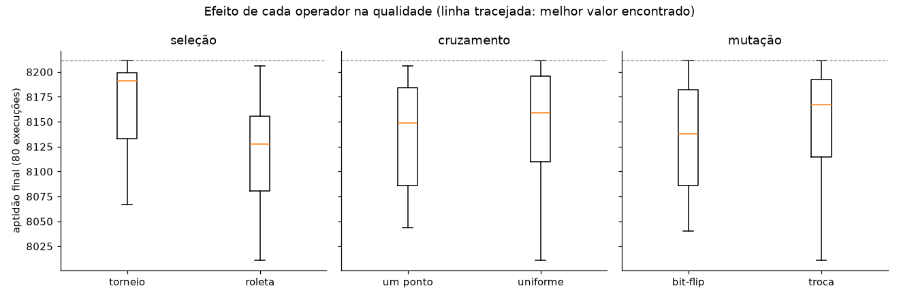
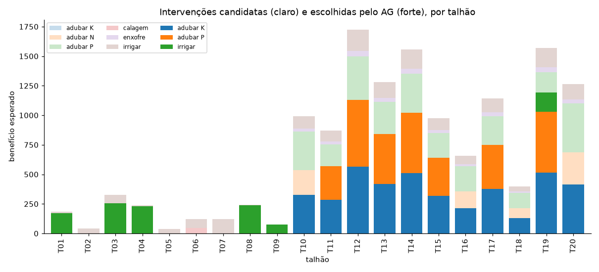
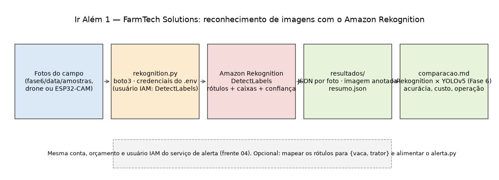

# Ir Além — Fase 7

Desafios opcionais do enunciado. Cada um tem um vídeo de até 4 minutos (não listado), com o link no
README da raiz e no `.txt` da entrega.

| Desafio | Pasta | Situação | Vídeo |
|---|---|---|---|
| Ir Além 1 — AWS Rekognition | [`ir-alem-1/`](ir-alem-1/) | ✅ executado na AWS real em 10/11/2026 (`resultados/`); faltam os prints restantes e o vídeo | a gravar |
| Ir Além 2 — Algoritmo genético | [`ir-alem-2/`](ir-alem-2/) | ✅ notebook executado em 09/11/2026 | a gravar |

## Ir Além 2 — Plano de manejo com algoritmo genético

**Problema:** com orçamento limitado, escolher quais intervenções (irrigar, calagem, enxofre, adubar N,
P ou K) executar em quais talhões para maximizar o ganho agronômico esperado. É uma **mochila binária**
montada a partir das leituras reais dos sensores da Fase 4 e das regras do serviço de alerta.

| Arquivo | Conteúdo |
|---|---|
| [`ir_alem_2_algoritmo_genetico.ipynb`](ir-alem-2/ir_alem_2_algoritmo_genetico.ipynb) | O notebook, já executado: problema, dados, AG do zero (NumPy), validação com força bruta e gulosa, comparação de 8 configurações de operadores, plano final, figura da arquitetura, parâmetros e conclusões |
| [`dados/talhoes.csv`](ir-alem-2/dados/talhoes.csv) | Entrada: 20 talhões gerados de `SOIL_DATA` por `gerar_dados.py` (semente fixa). O notebook só lê este arquivo |
| [`dados/plano_escolhido.csv`](ir-alem-2/dados/plano_escolhido.csv) | Saída: as intervenções escolhidas |
| [`figuras/`](ir-alem-2/figuras/) | `01-arquitetura.png` (autoral), `02-convergencia.png`, `03-operadores.png`, `04-qualidade-tempo.png`, `05-plano-por-talhao.png` |
| `construir_notebook.py` | Gera o `.ipynb` a partir das células em texto (facilita revisar no Git) |

### Como executar

```bash
cd IR-ALEM/ir-alem-2
uv sync
uv run jupyter lab ir_alem_2_algoritmo_genetico.ipynb      # abrir e rodar (≈ 20 s)
# ou executar sem abrir:
uv run jupyter nbconvert --to notebook --execute --inplace ir_alem_2_algoritmo_genetico.ipynb
# só se quiser refazer a entrada a partir do Oracle (.env da raiz):
uv run python gerar_dados.py --n 20
```

### Resultados (execução de 09/11/2026)

- 69 intervenções candidatas, custo total R$ 150.724, orçamento R$ 52.753 (35 %).
- Instância reduzida (18 itens): AG = força bruta = gulosa (benefício 3.514,75); AG em 0,04 s contra
  0,5 s da força bruta.
- Instância completa, 8 configurações × 10 sementes: torneio supera roleta em todas as combinações;
  cruzamento e mutação diferem pouco. Melhor plano: 24 intervenções, 100 % do orçamento, 59 % do
  benefício possível com 35 % do custo total, 99,8 % da heurística gulosa.





## Ir Além 1 — Reconhecimento de imagens com o Amazon Rekognition

**Ideia:** usar um serviço de visão computacional **pronto** da AWS nas mesmas fotos da Fase 6 e comparar
com o YOLOv5 que **nós** treinamos. O Rekognition devolve rótulos hierárquicos (*Animal → Mammal → Cattle
→ Cow*), a confiança de cada um e, para alguns rótulos, as caixas dos objetos.



| Arquivo | Conteúdo |
|---|---|
| [`rekognition.py`](ir-alem-1/rekognition.py) | Envia cada foto da pasta ao `DetectLabels`, grava o JSON completo em `resultados/<foto>.json`, desenha as caixas em `resultados/<foto>_rekognition.jpg` e, com `--comparar`, roda o YOLO da Fase 6 e escreve `resultados/comparacao.md` |
| [`figura_arquitetura.py`](ir-alem-1/figura_arquitetura.py) | Gera a figura autoral acima |
| `resultados/` | Execução real de 10/11/2026: um JSON por foto, as imagens anotadas (`*_rekognition.jpg`), `resumo.json` e [`comparacao.md`](ir-alem-1/resultados/comparacao.md) |

### Como executar (depois de configurar a AWS)

```bash
# no .env da raiz: AWS_REGION, AWS_ACCESS_KEY_ID e AWS_SECRET_ACCESS_KEY do usuário IAM
# com a permissão rekognition:DetectLabels, e AWS_ENDPOINT_URL comentado
python3 main.py ir-alem-1 --comparar                # 4 amostras da Fase 6 (~US$ 0,004)
python3 main.py ir-alem-1 --pasta outras_fotos      # qualquer pasta com jpg/png
```

A saída é um JSON resumido por foto (classe equivalente, confiança, nº de caixas e o resultado do YOLO).
`resultados/comparacao.md` traz a tabela lado a lado e a leitura crítica.

### Configuração no console e prints (campos explicados)

O `DetectLabels` não exige criar nada no Rekognition: a "configuração" é dar permissão e chamar a API.
Os prints que documentam a solução:

| Print | Onde | O que explicar |
|---|---|---|
| `ir-alem-1/prints/01-politica-iam.png` | IAM → Policies → `farmtech-fase7` (a mesma política do alerta) | **Action** `rekognition:DetectLabels` (só o que o script usa) e **Resource** `*` (o DetectLabels não é por recurso, então não dá para restringir mais); a outra declaração é o `sns:Publish` da frente 04 |
| `ir-alem-1/prints/02-usuario-iam.png` | IAM → Users → `farmtech-alerta` → Permissions | O usuário sem acesso ao console, só com a política `farmtech-fase7` (menor privilégio) |
| `ir-alem-1/prints/03-demo-console.png` | Rekognition → Label detection (demo) → Upload | A mesma foto enviada pelo console: **Results** lista os rótulos com confiança; **Request / Response** mostra o JSON que o script recebe (`Labels[].Name`, `Confidence`, `Instances[].BoundingBox` com `Left/Top/Width/Height` relativos à imagem, `Parents`) |
| `ir-alem-1/prints/04-terminal.png` | terminal | `python3 main.py ir-alem-1 --comparar` com o resumo por foto |
| `ir-alem-1/prints/05-comparacao.png` | `resultados/vaca_02_rekognition.jpg` ao lado de `fase6/saidas/vaca_02_*.jpg` | Caixa e rótulo do Rekognition (laranja) × caixa do YOLO (azul) na mesma foto |
| `ir-alem-1/prints/06-custo.png` | Billing → Bills (ou Credits) | O custo da chamada: 4 imagens × US$ 0,001 |

### Justificativa crítica

- **Precisão (execução de 10/11/2026):** os dois acertaram as 4 classes. Rekognition: trator 90 % e 81 %
  (o segundo como *Bulldozer*), vaca 99,6 % e 99,9 %. YOLO da Fase 6: trator 61 % e 74 %, vaca 60 % e 84 %.
  O Rekognition é mais confiante porque vaca e trator são comuns no treino dele; o YOLO viu só 32 fotos por classe.
- **Localização:** nas vacas os dois devolvem a caixa certa. No trator, o Rekognition rotula *Tractor* mas
  **não devolve a caixa do trator**: marca rodas, pessoa e pássaros (15 caixas em `trator_01`). O YOLO marca
  o trator inteiro. Para um alerta de "máquina na área" o que importa é onde ela está.
- **Facilidade:** o Rekognition não exige dataset, rotulagem nem treino; são 10 linhas de boto3. O YOLO exigiu
  montar o dataset do Open Images, rotular e treinar no Colab (toda a Fase 6).
- **Especificidade:** o Rekognition só conhece as classes dele. Para uma praga específica, um implemento ou um
  defeito de máquina da fazenda, só um modelo próprio como o da Fase 6 resolve.
- **Custo e dependência:** US$ 0,001 por imagem, internet e credenciais, versus um modelo que roda offline e
  pode ir para a borda (ESP32-CAM, drone), mas precisa de manutenção.
- **Para a FarmTech:** o Rekognition é a escolha certa para *começar* a monitorar o campo com câmeras sem
  equipe de ML; o YOLO próprio entra quando as classes forem específicas do negócio. Os dois alimentam o
  mesmo serviço de alerta: basta traduzir os rótulos para `{vaca, trator}` como `EQUIVALENCIAS` faz.
