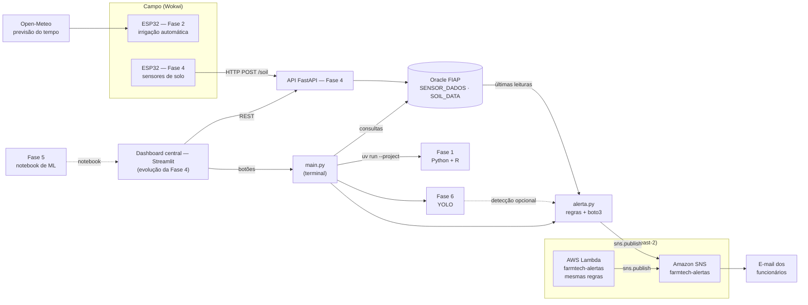
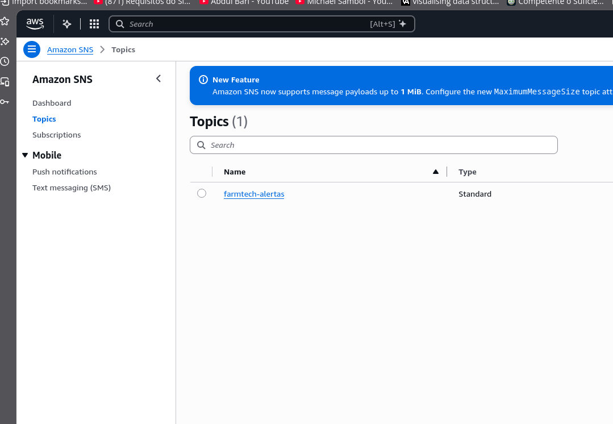
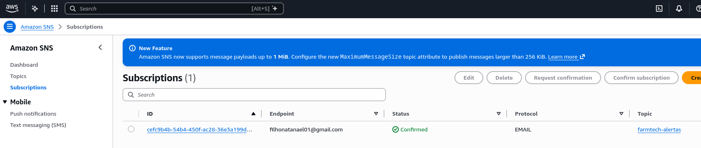
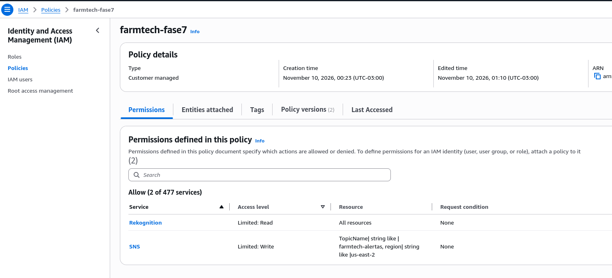
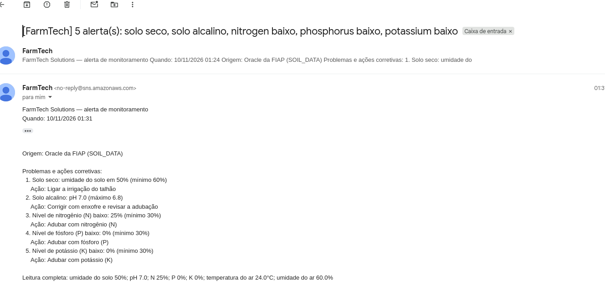
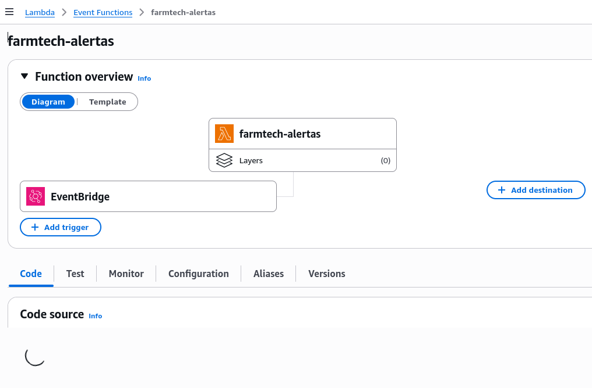

# FIAP - Faculdade de Informática e Administração Paulista

<p align="center">
<a href="https://www.fiap.com.br/"></a>
</p>

<br>

# FarmTech Solutions — Fase 7: A consolidação de um sistema

> Um único sistema de gestão da fazenda que reúne tudo o que a FarmTech construiu nas Fases 1 a 6
> e avisa os funcionários, por e-mail, quando os sensores pedem uma ação corretiva.

## 👨‍🎓 Integrantes

| Nome | RM |
|---|---|
| Jonattas Felipe | RM572692 |
| Natanael Filho | RM572474 |
| Pedro Henrique | RM571394 |
| Andrews Oliveira | RM572311 |

## 👩‍🏫 Professores

### Tutor(a)
- Sabrina Otoni

### Coordenador(a)
- <a href="https://www.linkedin.com/in/andregodoichiovato/">André Godoi Chiovato</a>

## 📜 Descrição

Ao longo do ano a FarmTech Solutions construiu peças separadas de uma solução de Agricultura 4.0:
cálculo de área e insumos, sensores de irrigação no ESP32, banco Oracle, dashboard com Machine
Learning, modelos preditivos e visão computacional. Nesta fase as peças viram **um sistema só**:

1. **Pasta única** com os serviços de cada fase, um por subpasta (`fase1/` … `fase6/`).
2. **Dashboard final**, evoluída da Fase 4, que dispara cada serviço por botão ou por comando de
   terminal.
3. **Serviço de alerta na AWS** (Amazon SNS) que monitora as leituras dos sensores e envia aos
   funcionários um e-mail com o problema e a **ação corretiva** sugerida.

Como os serviços só dependem dos dados que recebem, o mesmo sistema pode ser adaptado a outro
setor trocando as bases de dados.

## 🧭 Status da entrega

| Item do enunciado | Status |
|---|---|
| Pasta única com as Fases 1, 2, 3 e 6 (e 4 e 5) em subpastas | ✅ |
| Pastas das fases saneadas; documentação centralizada em [`docs/`](docs/) | ✅ |
| `.env` único na raiz, com o Oracle da FIAP | ✅ conexão testada em 08/11/2026 |
| Fase 6 como serviço: `detect.py` recebe uma imagem e devolve trator/vaca | ✅ testado em 08/11/2026 |
| Dashboard final que dispara cada serviço por botão (Central de serviços) | ✅ testado em 08/11/2026 |
| Comando de terminal que dispara cada serviço (`main.py`) | ✅ testado em 08/11/2026 |
| Serviço de alerta na AWS (SNS + e-mail) com ações corretivas | ✅ publicado na AWS real (`us-east-2`) em 10/11/2026; e-mail recebido |
| Prints do console da AWS comentados | ✅ na seção "Serviço de alertas na AWS" |
| Vídeo demonstrativo (até 10 min, não listado) | ✅ [publicado](https://www.youtube.com/watch?v=pPwR5JdXkLs) |
| Ir Além 2 (algoritmo genético) | ✅ notebook executado em 09/11/2026 ([`IR-ALEM/`](IR-ALEM/)) · [vídeo](https://www.youtube.com/watch?v=DPyKYEPvGrw) publicado |
| Ir Além 1 (AWS Rekognition) | ✅ executado na AWS em 10/11/2026 ([`IR-ALEM/`](IR-ALEM/)) · [vídeo](https://www.youtube.com/watch?v=dUIEMmM8TjQ) publicado |

O que falta, frente por frente, está no [plano de entrega](docs/plano-entrega/README.md).

## 🗺️ As fases dentro do sistema

| Fase | Código | O que entrega | Tecnologias |
|---|---|---|---|
| 1 — Base de dados inicial | [`fase1/`](fase1/) · [docs](docs/fases/fase1.md) | Programa de terminal que calcula área de plantio e insumos (manga e cana) e guarda os registros em CSV; estatística dos registros e clima da Open-Meteo em R | Python, R |
| 2 — IoT e automação | [`fase2/`](fase2/) · [docs](docs/fases/fase2.md) | ESP32 no Wokwi que liga a bomba de irrigação do tomate a partir de umidade (DHT22), pH (LDR) e N/P/K (botões), com LCD; previsão do tempo em Python (código S/L/C digitado no Monitor Serial do ESP32); regressão logística da decisão de irrigar em R | C++ (Arduino), Python, R |
| 3 — Banco de dados estruturado | [`fase3/`](fase3/) · [docs](docs/fases/fase3.md) | Tabela `SENSOR_DADOS` no Oracle (criação, carga e consultas) e dashboard Streamlit que lê o Oracle, com página de ML de recomendação de cultura | Oracle SQL, Python, Streamlit |
| 4 — Dashboard com Data Science | [`fase4/`](fase4/) · [docs](docs/fases/fase4.md) | ESP32 envia leituras de solo para uma API FastAPI, que grava no Oracle (`SOIL_DATA`); dashboard Streamlit treina uma Random Forest (scikit-learn) e prevê o próximo ciclo | Python, FastAPI, Oracle, Streamlit, C++ |
| 5 — Machine Learning na cabeça | [`fase5/`](fase5/) · [docs](docs/fases/fase5.md) | Notebook de rendimento de safra: análise exploratória, clusterização, outliers e cinco modelos de regressão | Python, scikit-learn |
| 6 — Visão computacional | [`fase6/`](fase6/) · [docs](docs/fases/fase6.md) | Notebook com YOLOv5 customizado (trator e vaca), comparado ao YOLO padrão e a uma CNN treinada do zero; pesos treinados em `models/best.pt` e serviço `src/detect.py` que detecta numa imagem e devolve JSON | Python, PyTorch, YOLOv5 |
| 7 — Consolidação | raiz · [plano](docs/plano-entrega/README.md) | Dashboard central e alerta na AWS | Streamlit, Amazon SNS |

As pastas das fases guardam só código e dados. O que cada fase faz, como rodar e os detalhes
técnicos estão em [`docs/fases/`](docs/fases/).

## 🏗️ Arquitetura

A dashboard central e o `main.py` são a Fase 7: os botões da dashboard chamam o `main.py`, que roda
cada fase no próprio ambiente. As linhas tracejadas são as partes opcionais ou que não se disparam
por botão: o notebook da Fase 5 e a detecção do YOLO como entrada do alerta.



## 🔔 Serviço de alertas na AWS

O serviço fica em [`alerta/`](alerta/) e roda por `python3 main.py alerta` ou pelo botão
"Verificar sensores e alertar" da dashboard central. Ele lê as leituras mais recentes dos sensores
da Fase 4 (`SOIL_DATA` no Oracle, ou a API com `--fonte api`), aplica as regras abaixo e publica um
e-mail com o problema e a **ação corretiva** num tópico do **Amazon SNS** (`farmtech-alertas`),
cujos assinantes são os e-mails dos funcionários. Opcionalmente, o resultado do YOLO da Fase 6 entra
na avaliação (`--yolo <json do detect.py>`).

```
Oracle SOIL_DATA (Fase 4) ──┐
                            ├──> alerta/regras.py ──> alerta/alerta.py ──> boto3 sns.publish ──> Amazon SNS ──> e-mail
detect.py (Fase 6, opcional)┘         funções puras      não repete a mesma     AWS_ENDPOINT_URL?  └─> floci (dev)
                                                         condição em < 60 min
```

| Condição (campo da Fase 4) | Problema | Ação corretiva enviada |
|---|---|---|
| `soil_moisture_percent` < 60 % | Solo seco | Ligar a irrigação do talhão |
| `ph` < 6,0 | Solo ácido | Aplicar calcário (calagem) |
| `ph` > 6,8 | Solo alcalino | Corrigir com enxofre e revisar a adubação |
| `nitrogen`, `phosphorus` ou `potassium` < 30 % | Nutriente baixo | Adubar com o nutriente em falta |
| YOLO detecta vaca (opcional) | Animal na lavoura | Verificar as cercas e afastar o rebanho |

Umidade e pH seguem o firmware da Fase 2 (`fase2/src/farmTech.ino`, cultura de referência: tomate).
Na Fase 4, N, P e K chegam como níveis de 0 a 100 %; o mínimo de 30 % foi uma decisão desta fase.
As regras têm testes (`cd alerta && uv run pytest`).

- **Desenvolvimento local (pronto):** o [`docker-compose.yaml`](docker-compose.yaml) sobe o
  [floci](https://floci.io/), emulador da AWS na porta 4566. `python3 main.py alerta-floci preparar`
  cria o tópico e uma fila SQS assinante; `python3 main.py alerta-floci ler` mostra as mensagens que
  chegaram. Com `AWS_ENDPOINT_URL=http://localhost:4566` no `.env`, o mesmo código boto3 fala com o floci.
- **AWS real (em uso desde 10/11/2026):** tópico, assinatura e usuário IAM na região `us-east-2`,
  com o passo a passo em [`docs/plano-entrega/04-alerta-aws.md`](docs/plano-entrega/04-alerta-aws.md).
  O `.env` aponta para a AWS quando a linha `AWS_ENDPOINT_URL` está comentada.

### Evidências no console da AWS

**1. Tópico SNS.** O tópico `farmtech-alertas`, do tipo Standard, é o canal único dos alertas: o
`alerta.py` e a Lambda publicam nele, e a AWS entrega a mensagem a todos os assinantes.



**2. Assinatura de e-mail confirmada.** Cada funcionário que deve receber os alertas entra como uma
assinatura do protocolo EMAIL. A AWS só entrega depois que a pessoa confirma pelo link, por isso o
status **Confirmed** é a prova de que o e-mail está ativo.



**3. Permissão mínima no IAM.** A política `farmtech-fase7` é a única do usuário `farmtech-alerta`,
cuja chave o `alerta.py` usa, e da role da Lambda. No SNS ela só permite publicar (Limited: Write) e
só no tópico `farmtech-alertas` em `us-east-2`. Se a chave vazar, não serve para mais nada na conta.
A outra permissão, leitura no Rekognition, é a do Ir Além 1.



**4. E-mail recebido.** Alerta real enviado por `python3 main.py alerta` a partir da última leitura de
`SOIL_DATA` no Oracle: umidade 50 %, pH 7,0, N 25 %, P e K 0 %. Os cinco problemas chegam com a ação
corretiva de cada um, e o remetente `no-reply@sns.amazonaws.com` confirma que passou pelo SNS.



**5. As mesmas regras numa Lambda.** A função `farmtech-alertas` roda dentro da AWS o mesmo código de
regras ([`alerta/lambda_function.py`](alerta/lambda_function.py)): recebe uma leitura em JSON, avalia
e publica no mesmo tópico. O gatilho do EventBridge já está ligado para execuções agendadas. Como a
Lambda não alcança o Oracle da FIAP, hoje ela avalia a leitura enviada no evento; buscar as leituras
direto da nuvem é a próxima melhoria.



## 📁 Estrutura de pastas

```
.
├── README.md             # este arquivo: documentação integrada do sistema
├── COMO_USAR.md          # passo a passo e registro do que mudou em cada etapa
├── main.py               # dispara qualquer serviço pelo terminal (python3 main.py listar)
├── .env.example          # modelo do .env único (Oracle, API, AWS)
├── alerta/               # Fase 7: regras.py, alerta.py (SNS), floci.py (AWS local), test_regras.py
├── IR-ALEM/              # desafios opcionais
│   ├── ir-alem-1/        #   Rekognition: rekognition.py, figuras/, resultados/ (após a execução na AWS)
│   └── ir-alem-2/        #   algoritmo genético: notebook, dados/talhoes.csv, figuras/
├── docker-compose.yaml   # floci: AWS local para desenvolver o alerta
├── assets/               # logo da FIAP usado neste README
├── docs/                 # documentação
│   ├── plano-entrega/    #   o que falta para a entrega, por frente de trabalho
│   ├── fases/            #   detalhes de cada fase (fase1.md … fase6.md)
│   └── imagens/          #   prints e figuras
├── fase1/                # Python (área e insumos) + R (estatística e clima)
│   └── src/              #   main.py (interativo), calculo.py (sem perguntas), CSV e Rscripts/
├── fase2/                # ESP32 de irrigação (Wokwi) + Python (clima) + R (regressão)
│   ├── src/              #   farmTech.ino, main.py, irrigacao.r
│   └── diagram.json      #   circuito do Wokwi
├── fase3/                # Oracle: create_table.sql, insert_dados.sql, consulta.sql
│   ├── consultas.py      #   roda o consulta.sql no Oracle pelo terminal
│   └── dashboard/        #   Streamlit que lê o Oracle + página de ML
├── fase4/                # sistema da Fase 4
│   ├── src/              #   api.py (FastAPI), app.py (dashboard central), core/, paginas/
│   │   ├── paginas/      #     inicio.py, analise_solo.py (Fase 4 original), central.py (botões)
│   │   └── core/         #     ml_pipeline.py (Random Forest) e servicos.py (ponte com o main.py)
│   └── iot/              #   ESP32 que envia as leituras para a API
├── fase5/                # notebook de rendimento de safra + crop_yield.csv
└── fase6/                # YOLO
    ├── src/              #   detect.py (serviço de detecção) e notebook de treino e comparação
    ├── data/amostras/    #   fotos de exemplo (Wikimedia Commons) com LICENCAS.md
    └── models/best.pt    #   pesos treinados (trator e vaca, YOLOv5s, 30 épocas)
```

## 🔧 Como executar

### Pré-requisitos

- [uv](https://docs.astral.sh/uv/) (cada fase tem o seu ambiente; o uv baixa a versão de Python certa)
- R 4.2+ (Fases 1 e 2)
- VS Code com as extensões PlatformIO e Wokwi (ESP32 das Fases 2 e 4)
- Acesso à internet (Oracle da FIAP e Open-Meteo)
- Docker, só para testar o alerta localmente com o floci

### 1. Configurar o `.env` único

```bash
cp .env.example .env    # preencha ORACLE_USER e ORACLE_PASSWORD
```

Um `.env` na raiz serve para todas as fases: o `load_dotenv()` de cada script sobe as pastas até
encontrá-lo.

### 2. Disparar os serviços pelo terminal: `main.py`

O `main.py` da raiz é o ponto de entrada único. Ele só usa a biblioteca padrão do Python e roda
cada fase no próprio ambiente (`uv run --project`), então basta ter o `uv` instalado.

```bash
python3 main.py listar                                   # todos os serviços
python3 main.py fase1                                    # programa interativo da Fase 1
python3 main.py fase1-calculo --cultura cana --raio 50 --kg-por-m2 0.2
python3 main.py fase1-estatistica                        # R
python3 main.py fase2-clima                              # código S/L/C para o ESP32
python3 main.py fase3-consultas                          # consultas do Oracle no terminal
python3 main.py fase3-dashboard                          # Streamlit da Fase 3 (porta 8502)
python3 main.py fase4-api                                # API (porta 8000)
python3 main.py fase4-dashboard                          # dashboard central
python3 main.py fase6 fase6/data/amostras/vaca_02.jpg    # detecção com o YOLO
```

| Serviço | O que roda | Precisa de |
|---|---|---|
| `fase1` | Programa interativo de área e insumos (manga e cana), dados em CSV | uv |
| `fase1-calculo` | Mesmo cálculo sem perguntas, com JSON na saída (usado pela dashboard); `--salvar` grava no CSV | uv |
| `fase1-estatistica` / `fase1-clima` | Scripts em R da Fase 1 | R |
| `fase2-clima` | Previsão de chuva da Open-Meteo e código S/L/C para o ESP32 | uv |
| `fase2-regressao` | Regressão logística da decisão de irrigar, em R | R |
| `fase3-consultas` | Executa `fase3/consulta.sql` no Oracle e imprime as tabelas (`--json` para outro programa) | uv, `.env` |
| `fase3-dashboard` | Streamlit da Fase 3 na porta 8502 | uv, `.env` |
| `fase4-api` | API FastAPI (porta 8000) | uv, `.env` |
| `fase4-dashboard` | Dashboard central (porta 8501): Início, Análise de solo (Fase 4) e **Central de serviços** com um botão por fase | uv, `.env` |
| `fase6 <imagem>` | Detecção de trator e vaca; JSON na saída e imagem anotada em `fase6/saidas/` | uv |
| `alerta` | Avalia as leituras e publica os alertas no SNS (`--simular seco`, `--dry-run`, `--yolo`) | uv, `.env` |
| `alerta-floci` | `preparar`, `ler` ou `limpar` o SNS/SQS do floci | uv, Docker |
| `ir-alem-1 [--comparar]` | Envia as fotos ao Amazon Rekognition e compara com o YOLO da Fase 6 | uv, `.env` com chaves da AWS |

Argumentos depois do nome do serviço são repassados a ele (`python3 main.py fase6 foto.jpg --conf 0.4`).
Quando falta algo (uv, R, `.env`), o `main.py` diz o que instalar ou configurar.

### 3. Rodar cada fase diretamente

Os mesmos serviços, sem o `main.py`:

| Fase | Comando |
|---|---|
| 1 — cálculo de área e insumos | `cd fase1/src && uv run main.py` (interativo) ou `uv run python calculo.py --cultura manga ...` |
| 1 — estatística em R | `cd fase1/src && Rscript Rscripts/python-consumer.r` |
| 2 — previsão do tempo para o ESP32 | `cd fase2 && uv run python src/main.py` |
| 2 — regressão logística em R | `cd fase2 && Rscript src/irrigacao.r` |
| 2 — ESP32 de irrigação | abrir `fase2/` no VS Code e iniciar a simulação do Wokwi |
| 3 — dashboard do Oracle | `cd fase3/dashboard && uv run streamlit run app.py --server.port 8502` |
| 3 — consultas no terminal | `uv run --project fase3/dashboard python fase3/consultas.py` |
| 3 — scripts SQL | rodar `fase3/create_table.sql`, `insert_dados.sql` e `consulta.sql` no Oracle SQL Developer |
| 4 — API | `cd fase4/src && uv run uvicorn api:app --port 8000` |
| 4 — dashboard | `cd fase4/src && uv run streamlit run app.py` |
| 4 — ESP32 de solo | abrir `fase4/iot/` no VS Code e iniciar a simulação do Wokwi (envia para a API na porta 8000) |
| 5 — notebook | `cd fase5 && python -m venv .venv && source .venv/bin/activate && pip install -r requirements.txt && jupyter lab pbl_fase5.ipynb` |
| 6 — detecção de trator e vaca | `cd fase6 && uv sync && uv run python src/detect.py data/amostras/vaca_02.jpg` (JSON no terminal; imagem anotada em `fase6/saidas/`) |
| 6 — notebook do YOLO | `cd fase6 && uv sync --group notebook && uv run jupyter lab` (ou abrir no Google Colab) |
| Alerta (local) | `docker compose up -d` (floci na porta 4566), depois `cd alerta && uv run python alerta.py --simular seco` |

## 🎬 Vídeo demonstrativo

| Vídeo | Link |
|---|---|
| Apresentação principal (entrega da Fase 7) | https://www.youtube.com/watch?v=pPwR5JdXkLs |
| Ir Além 1 — Amazon Rekognition | https://www.youtube.com/watch?v=dUIEMmM8TjQ |
| Ir Além 2 — Algoritmo genético | https://www.youtube.com/watch?v=DPyKYEPvGrw |

## 🗃 Histórico de lançamentos

* 0.8.0 — 10/11/2026: alerta publicado na AWS real (SNS em `us-east-2`, usuário IAM com permissão
  mínima e Lambda com as mesmas regras), prints do console comentados e links dos três vídeos.
* 0.7.0 — 09/11/2026: Ir Além 1 (`IR-ALEM/ir-alem-1/`): script do Rekognition com comparação ao YOLO,
  figura e justificativa; cronograma de execução na AWS em `docs/plano-entrega/cronograma-aws.md`.
* 0.6.0 — 09/11/2026: Ir Além 2 em `IR-ALEM/ir-alem-2/`: plano de manejo com orçamento limitado
  resolvido por algoritmo genético do zero, validado com força bruta e comparado em 8 configurações.
* 0.5.0 — 08/11/2026: serviço de alerta (`alerta/`) com regras testadas, publicação no SNS via boto3,
  controle de repetição, botão na dashboard e ambiente local no floci.
* 0.4.0 — 08/11/2026: dashboard central com as páginas Início, Análise de solo (Fase 4) e Central
  de serviços, que dispara as Fases 1, 2, 3 e 6 por botão chamando o `main.py`.
* 0.3.0 — 08/11/2026: `main.py` na raiz dispara cada serviço pelo terminal; Fase 1 ganha o
  `calculo.py` sem perguntas e a Fase 3 o `consultas.py` que roda o SQL no Oracle.
* 0.2.0 — 08/11/2026: Fase 6 vira serviço (`fase6/src/detect.py`) com imagens de amostra e
  ambiente leve com PyTorch para CPU. Detalhes das mudanças em [`COMO_USAR.md`](COMO_USAR.md).
* 0.1.0 — 08/11/2026: Fases 1 a 6 reunidas em pasta única e saneadas, `.env` único na raiz,
  documentação centralizada em `docs/` (fases e plano de entrega) e README integrado.

## 📋 Licença

<p xmlns:cc="http://creativecommons.org/ns#" xmlns:dct="http://purl.org/dc/terms/"><a property="dct:title" rel="cc:attributionURL" href="https://github.com/fiap-tutoria/FIAP-PORTFOLIO-AI">TEMPLATE - FIAP PORTFÓLIO AI</a> por <a rel="cc:attributionURL dct:creator" property="cc:attributionName" href="https://fiap.com.br">FIAP</a> está licenciado sobre <a href="http://creativecommons.org/licenses/by/4.0/?ref=chooser-v1" target="_blank" rel="license noopener noreferrer" style="display:inline-block;">Attribution 4.0 International</a>.</p>
