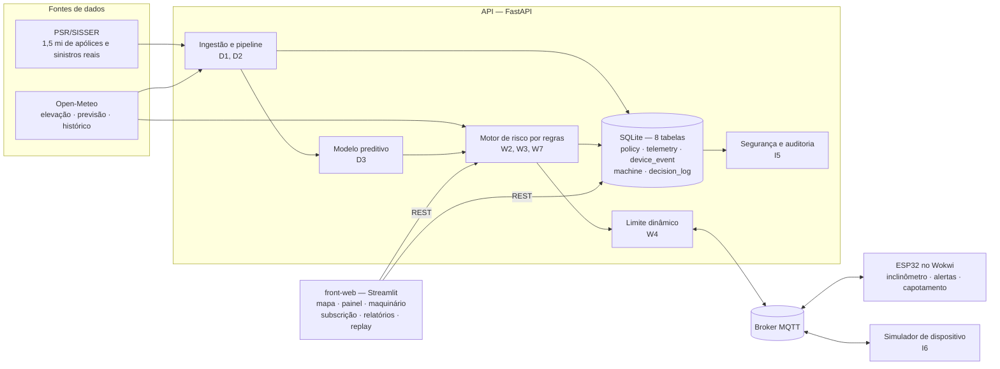
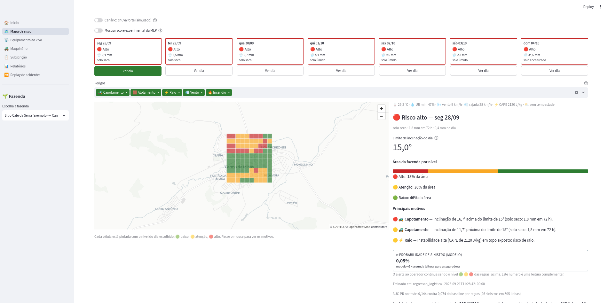
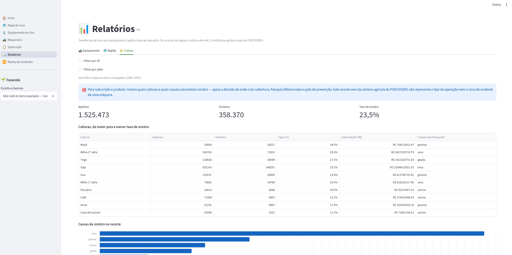
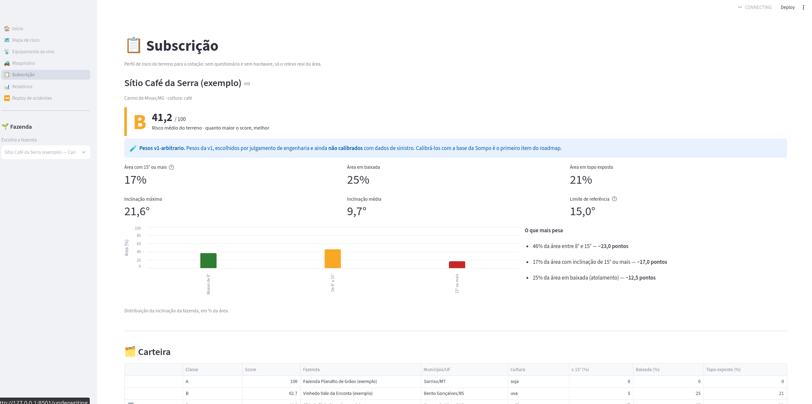
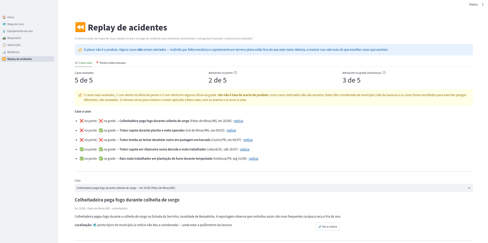

# FIAP - Faculdade de Informática e Administração Paulista

<p align="center">
<a href="https://www.fiap.com.br/"></a>
</p>

<br>

# Sompo AgriShield — Relevo × Clima

> **Um terreno inclinado que é seguro hoje pode capotar um trator amanhã.**

> 🏆 **Este grupo deseja concorrer ao prêmio de melhor projeto Sompo.** A solução pode ser
> compartilhada com a empresa, nos termos do enunciado do Challenge.

## 👨‍🎓 Integrantes

| Nome | RM | Turma |
| -- | -- | -- |
| Jonattas Felipe | RM572692 | 1TIAOB |
| Natanael Filho | RM572474 | 1TIAOB |
| Pedro Henrique | RM571394 | 1TIAOB |
| Andrews Oliveira | RM572311 | 1TIAOB |

## 👩‍🏫 Professores:
### Tutor(a)
- <a href="https://github.com/SabrinaOtoni">Sabrina Otoni</a>

## 📜 O que é

O seguro de máquinas agrícolas no Brasil é reativo: a seguradora só age depois do acidente. E um dos
fatores que mais pesam no risco, **o relevo**, praticamente não é considerado. Uma encosta de 12° é
tranquila com o solo seco; depois de 40 mm de chuva o solo perde aderência e a mesma encosta passa a
ter risco de capotamento. Nas baixadas a máquina atola, e as cristas expostas pegam raio e rajada.

O **Sompo AgriShield** cruza **relevo** e **clima** para prevenir esses acidentes, e entrega quatro
coisas:

1. **Mapa de risco por talhão e por dia.** Da elevação por satélite calculamos inclinação,
   orientação e classe de terreno de cada fazenda. Cruzando com a previsão do tempo, o sistema
   mostra por 7 dias **onde e quando** operar é perigoso — sempre com o motivo, em números.
2. **Limite de inclinação dinâmico na máquina.** A plataforma calcula o limite seguro do dia
   (ex.: 15° com solo seco, 10° encharcado) e o envia por MQTT a um **ESP32** instalado no
   equipamento, que mede a inclinação real e alerta o operador na hora, mesmo sem internet.
3. **Perfil de terreno para subscrição.** Na cotação, a Sompo vê um perfil objetivo do terreno
   (área íngreme, baixadas, áreas expostas, classe A/B/C), sem questionário e sem hardware.
4. **Registro da frota.** Cada máquina é cadastrada e vinculada ao dispositivo instalado nela, para
   se saber **de qual máquina** vem cada alerta.

## ⚙️ Como funciona

### Arquitetura final: entrada → banco → modelo → saída



**O caminho completo, em sete passos:** as apólices do PSR são baixadas, anonimizadas e carregadas
(D1) → cruzadas com relevo e clima da vigência viram o dataset (D2) → o modelo é treinado e
comparado ao baseline por regras (D3) → o ESP32 publica inclinação e eventos por MQTT, que a API
valida, deduplica e grava (I2, I3) → o motor cruza relevo e clima e gera nível, motivo e **limite do
dia**, com o modelo ao lado (W2, W3, W13) → o resultado sai no mapa, no painel, nos relatórios e
**de volta na máquina** (W1–W14) → e cada decisão vai para a trilha de auditoria (I5).

**O alerta ao operador vem de regras explicáveis**, não de um modelo caixa-preta: cada alerta mostra
o motivo com o número que o disparou (*"42 mm de chuva em 72 h: solo encharcado, limite cai para
10°"*). Os limiares vivem em um documento só, [regras-de-risco.md](document/regras-de-risco.md), e
o código os lê de lá.

Ao lado das regras, um **modelo preditivo treinado com 2.256 apólices reais** do seguro rural
(PSR/SISSER) dá uma segunda leitura para a seguradora. Ele supera o baseline por regras no teste de
2024, mas com ressalvas do tamanho do número — por isso **informa, e não decide**.

Três responsabilidades separadas, e a separação é verificável no código:

| Camada | O que faz | O que **não** faz |
|---|---|---|
| `api/` | Calcula todo o risco, publica o limite, guarda telemetria e a trilha de auditoria | — |
| `front-web/` | Só exibe o que a API já calculou | nenhuma regra de negócio |
| `iot/` | Mede a inclinação e aplica o limite que recebeu | não decide o limite |

Fluxos e endpoints em [arquitetura.md](document/arquitetura.md) · estrutura do banco em
[esquema-do-banco.md](document/esquema-do-banco.md) · contrato MQTT em
[contrato-mqtt.md](document/contrato-mqtt.md) · pipeline e modelo em
[dados-e-modelo.md](document/dados-e-modelo.md).

📖 **Detalhe completo** — arquitetura, cada feature com o código e como vê-la funcionando, onde há
IA no projeto, as decisões e as limitações declaradas: **[document/guia-do-projeto.md](document/guia-do-projeto.md)**.

## 🧩 Decisões técnicas

As escolhas que explicam o sistema, com o registro completo (contexto, decisão e consequências) em
[decisoes.md](document/decisoes.md):

| Decisão | Por quê |
|---|---|
| **Relevo × clima** em vez do MVP amplo original ([ADR-001](document/decisoes.md), [002](document/decisoes.md)) | A Sompo apontou que nenhum projeto tratava terreno; e cortar escopo foi o que tornou a entrega possível no prazo |
| **O alerta vem de regras, não do modelo** ([ADR-006](document/decisoes.md), [010](document/decisoes.md)) | O rótulo disponível é sinistro de seguro agrícola, não acidente de máquina. O modelo informa a seguradora; quem alerta o operador são regras auditáveis |
| **Regra de negócio só na API** ([ADR-004](document/decisoes.md)) | O front só exibe e o firmware só aplica o limite recebido — a regra existe em um lugar, testável |
| **Nenhum dado pessoal** ([ADR-011](document/decisoes.md)) | Nome e documento do CSV público são descartados na leitura, com teste que falha se algo escapar |
| **Chave de API com falha fechada** ([ADR-013](document/decisoes.md)) | Sem chave configurada, nenhuma escrita é aceita: esquecer de configurar não abre porta |
| **O cadastro da máquina não decide o limite** ([ADR-014](document/decisoes.md)) | Uma tela não pode mudar, sem revisão, o número que chega ao operador |
| **SQLite e Open-Meteo como fonte única** ([ADR-005](document/decisoes.md), [009](document/decisoes.md)) | Poucas partes móveis: menos coisas para quebrar na demo e menos ambiente para montar |

O **diagrama consolidado** (entrada → banco → modelo → saída) está em
[arquitetura.md](document/arquitetura.md#diagrama-final-entrada--banco--modelo--saída).

## 🚀 Como usar

### Em Docker (não precisa instalar nada)

```bash
cp docker/.env.example .env      # escolha uma chave em AGRISHIELD_API_KEY
docker compose up --build
```

Sobem três serviços: front, API e broker MQTT.

| | |
|---|---|
| Front-web | http://localhost:8501 |
| API (documentação interativa) | http://localhost:8000/docs |
| Broker MQTT | `localhost:1883` |

Os relatórios vêm vazios até carregar a amostra de sinistros reais:

```bash
docker compose run --rm api python scripts/load_psr.py --sample
```

O ESP32 não tem container (é simulado), mas conversa com o broker do compose pelo **IP da sua
máquina na LAN** — como apontar o firmware e os problemas comuns estão em
[docker/README.md](docker/README.md).

### Sem Docker

Precisa de Python 3.11+ e **[uv](https://docs.astral.sh/uv/)** (ou pip):

```bash
cp api/.env.example api/.env                 # escolha uma chave em AGRISHIELD_API_KEYS
cp front-web/.env.example front-web/.env     # AGRISHIELD_API_KEY = uma das chaves acima
./scripts/run-demo.sh --aquecer              # sobe API + front e aquece o cache
```

Este é o caminho da **apresentação**: o script confere o ambiente, avisa se as duas chaves não
combinarem, espera o `/health`, aquece o cache da Open-Meteo e derruba tudo com um Ctrl+C.
No Windows, use o WSL ou suba as duas partes à mão:

```bash
cd api        && uv sync && uv run fastapi dev app/main.py     # http://localhost:8000/docs
cd front-web  && uv sync && uv run streamlit run app.py        # http://localhost:8501
```

Para rodar a suíte de testes (sem rede: a Open-Meteo e o MQTT são simulados):

```bash
cd api && uv run pytest ; cd ../front-web && uv run pytest
```

### O dispositivo (ESP32)

O equipamento é **simulado no Wokwi**, no navegador — não há hardware físico:

- **Simulação pública pronta:** [abrir no Wokwi](https://wokwi.com/projects/476164477397501953)
- **No VS Code:** abra `iot/`, rode `pio run`, depois `F1` → *Wokwi: Start Simulator*

Passo a passo, circuito e tabela de ângulos: [iot/README.md](iot/README.md).

### As telas

| Tela | O que mostra |
|---|---|
| **Mapa de risco** | Relevo da fazenda e a previsão de 7 dias, célula a célula, com o motivo de cada alerta |
| **Equipamento ao vivo** | Telemetria do ESP32 chegando, limite do dia e alerta de capotamento com o contexto |
| **Maquinário** | Cadastro das máquinas e vínculo com o dispositivo instalado em cada uma |
| **Subscrição** | Perfil de terreno da carteira: score 0–100 e classe A/B/C |
| **Relatórios** | Tendências por equipamento, região e cultura, com exportação em CSV |
| **Replay de acidentes** | O motor rodando na data e no local de acidentes reais noticiados |

**Mapa de risco — a previsão de 7 dias.** Cada alerta traz a conta que o gerou: *"inclinação de
16,7° acima do limite de 15° (solo seco: 1,8 mm em 72 h)"*.



**Relatórios — tendências sobre 1,5 milhão de apólices reais.** Aqui a aba por cultura, com a taxa
de sinistro e a causa mais frequente de cada uma.



**Subscrição — o terreno na cotação.** Classe A/B/C e score 0–100, com a nota declarando que os
pesos da v1 ainda **não** foram calibrados com dados de sinistro.



**Replay — a validação mais honesta do projeto.** O motor rodado na data e no lugar de cinco
acidentes reais: **2 de 5** teriam alertado no ponto, e os três "não" ficam à vista com o motivo.



> Mais capturas, com legenda e descrição, em
> [`document/AgriShield-documentacao-da-entrega.docx`](document/AgriShield-documentacao-da-entrega.docx)
> e em [`document/evidencias/prints/`](document/evidencias/prints/).

## 📁 Estrutura de pastas

- <b>api</b>: backend **FastAPI** — motor de risco, Open-Meteo, ponte MQTT, SQLite. [api/README.md](api/README.md)
- <b>front-web</b>: front **Streamlit**, que só exibe dados da API. [front-web/README.md](front-web/README.md)
- <b>iot</b>: firmware **ESP32** (PlatformIO + Wokwi). [iot/README.md](iot/README.md)
- <b>document</b>: documentação técnica e decisões — comece pelo [guia do projeto](document/guia-do-projeto.md). [document/README.md](document/README.md)
- <b>feature</b>: especificação de cada feature, com critérios de aceite. [feature/README.md](feature/README.md)
- <b>docker</b>: Dockerfiles, broker MQTT e modelo de `.env`. [docker/README.md](docker/README.md)
- <b>data</b>: amostra versionada do PSR, dataset de treino e brutos fora do Git. [data/README.md](data/README.md)
- <b>scripts</b>: demo, pipeline de dados, simulador de dispositivo e medições. [scripts/readme.md](scripts/readme.md)
- <b>.claude</b> · <b>.github</b> · <b>assets</b> · <b>config</b> · <b>CLAUDE.md</b> · <b>LICENSE</b>

## ⚠️ O que este projeto não é

Declarado para não gerar expectativa errada:

- **Não há hardware embarcado real.** O ESP32 é simulado no Wokwi.
- **O modelo estima sinistro de seguro agrícola** (perda de lavoura), não acidente de máquina — é a
  base pública que existe. Calibrar com a base de sinistros de máquinas da Sompo é o roadmap.
- **Não é ambiente de produção.** A demo usa broker MQTT público e leituras sem autenticação; o que
  produção exigiria está em [contrato-mqtt.md](document/contrato-mqtt.md) e
  [backlog-pos-entrega.md](document/backlog-pos-entrega.md).
- **Nenhum dado pessoal** entra no banco ou no repositório: nomes e documentos do CSV público são
  descartados na leitura, com teste que falha se algo escapar.

## 📈 Evolução ao longo das 4 sprints

| Sprint | O que foi entregue |
|---|---|
| **1** | **Monitoramento de risco para plantações a partir de dados climáticos**, consumindo API meteorológica — a primeira versão da ideia de cruzar clima com risco agrícola |
| **2** | **Front-end conectado a essa API** — a primeira interface do produto, com o risco climático saindo do código e virando tela |
| **3** | **Conexão com IoT.** Essa implementação **foi descontinuada** e não faz parte do sistema atual: a camada de dispositivo foi refeita do zero na Sprint 4 |
| **4** | Sistema completo: plataforma, dispositivo, dados e modelo, integração, segurança e documentação |

### O arco: as três camadas se somaram, e a quarta virou o produto

Cada sprint acrescentou uma camada, e a última mudou **o que se cruza com o clima**:

1. **Sprint 1 — o clima.** Ler previsão de uma API e transformar em risco agrícola. É a espinha
   dorsal que continua até hoje, agora pela Open-Meteo.
2. **Sprint 2 — a tela.** O risco deixou de ser saída de código e virou interface. O front atual,
   em Streamlit, herda esse papel e a mesma regra: ele **só exibe** o que a API calculou.
3. **Sprint 3 — o dispositivo.** A primeira tentativa de levar o sistema ao equipamento. Ela não
   sobreviveu: a camada IoT foi **refeita** na Sprint 4 sobre **ESP32 + MQTT simulado no Wokwi**
   ([ADR-003](document/decisoes.md)), que é o que está no ar. O aprendizado ficou; o código, não.
4. **Sprint 4 — o relevo, e o destinatário.** A virada decisiva foi cruzar o clima com o **relevo**
   — o fator que a Sompo apontou como ausente nos outros projetos — e entregar o resultado ao
   **operador da máquina**, na forma de um limite de inclinação que chega ao equipamento.

Em uma frase: **o projeto começou perguntando "que risco o clima traz para a lavoura?" e terminou
perguntando "este terreno, hoje, é seguro para esta máquina?"**.

As duas decisões que explicam a virada estão registradas em
[decisoes.md](document/decisoes.md): a **ADR-001**, que trocou o MVP amplo do Passaporte Digital
pelo foco em relevo × clima, e a **ADR-002**, que cortou app mobile, BLE e fraude para caber no
prazo.

**Estado feature a feature, correções de rota e o que ainda falta:**
[feature/README.md](feature/README.md) · [document/entregaveis.md](document/entregaveis.md) ·
[document/evidencias/](document/evidencias/).

## 🎬 Vídeo da entrega

Até 5 minutos, com narração humana, publicado no YouTube como **não listado**.

**▶️ https://youtu.be/5-dttjN-_oI**

Roteiro e decisões de gravação: [roteiro-video.md](document/roteiro-video.md). 
Para gravar o vídeo da entrega, use também o roteiro pronto em [VIDEO_ROTEIRO.txt](VIDEO_ROTEIRO.txt).

## ✅ Checklist final da entrega

Antes de enviar no Portal do Aluno, confirme os itens abaixo:

### Modelo do arquivo de entrega (`ENTREGA.txt`)

Use o arquivo [ENTREGA.txt](ENTREGA.txt) como base para o envio. Ele já contém o formato correto com:

- link do repositório GitHub privado
- link do vídeo demonstrativo

Edite os campos com os links finais antes do envio.


- [ ] Repositório GitHub privado está acessível para `fiap-tutoria`.
- [ ] O README contém o nome completo dos integrantes e RM completos.
- [ ] O README contém o link do vídeo demonstrativo publicado como **não listado**.
- [ ] O vídeo tem até 10 minutos e mostra fluxo completo: dashboard, API, dados e dispositivo.
- [ ] O arquivo `.txt` enviado na plataforma contém apenas:
  - link do repositório GitHub privado
  - link do vídeo demonstrativo
- [ ] O projeto foi validado em ambiente local com `docker compose up --build` ou `uv run ...`.
- [ ] A documentação e o código estão organizados em subpastas por serviço/fase.
- [ ] Os prints e evidências estão no diretório [document/evidencias/](document/evidencias/).
- [ ] O `.env` e os dados sensíveis não foram commitados no repositório público.

## ⚠️ O que ainda precisa melhorar antes da entrega final

O projeto já está bem estruturado, mas os pontos mais importantes para revisar antes do envio são:

1. **Validação final do ambiente local**
   - Rodar a API, front e simulação do dispositivo em um ambiente real.
   - Garantir que os passos de setup funcionam sem erro.

2. **Link real do GitHub privado e do vídeo**
   - O README e o arquivo `.txt` precisam refletir os links definitivos da entrega.
   - Não deixar placeholders para o professor/coordenação.

3. **Checar o README para o formato acadêmico**
   - Nome completo + RM em ordem correta.
   - Descrição final do sistema, objetivos e funcionamento claros.
   - Vídeo e documentação claramente vinculados.

4. **Testes e evidências finais**
   - Validar a execução da API e do front em um ambiente sem bloqueios de rede.
   - Confirmar se os relatórios e as telas abrem corretamente.

5. **Conformidade com o enunciado**
   - Garantir que a estrutura das pastas, os prints e o README seguem o que foi pedido pela disciplina.
   - Confirmar que o repositório está privado e com acesso correto.

## 📋 Licença

Este projeto está licenciado sob a **Licença MIT**. Veja o arquivo [LICENSE](LICENSE).

O modelo deste README é baseado no <a href="https://github.com/agodoi/template">MODELO GIT FIAP</a>, da <a href="https://fiap.com.br">Fiap</a>, licenciado sob <a href="http://creativecommons.org/licenses/by/4.0/?ref=chooser-v1" target="_blank" rel="license noopener noreferrer">Attribution 4.0 International</a>.
