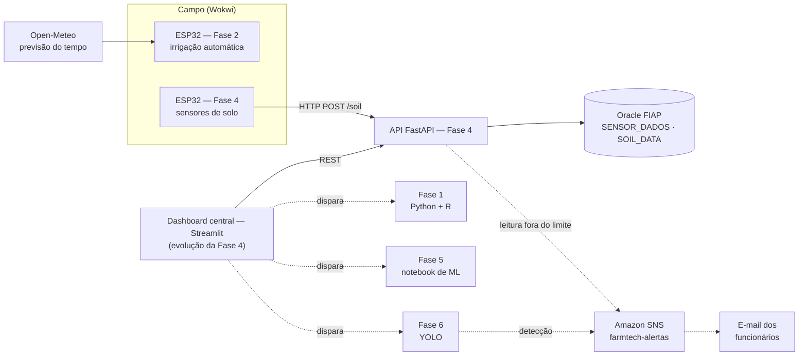

# FIAP - Faculdade de Informática e Administração Paulista

<p align="center">
<a href="https://www.fiap.com.br/"></a>
</p>

<br>

# FarmTech Solutions — Fase 7: A consolidação de um sistema

> Um único sistema de gestão da fazenda que reúne tudo o que a FarmTech construiu nas Fases 1 a 6
> e avisa os funcionários, por e-mail, quando os sensores pedem uma ação corretiva.

## 👨‍🎓 Integrantes

| Nome | RM |
|---|---|
| Jonattas Felipe | RM572692 |
| Natanael Filho | RM572474 |
| Pedro Henrique | RM571394 |
| Andrews Oliveira | RM572311 |

## 👩‍🏫 Professores

### Tutor(a)
- Sabrina Otoni

### Coordenador(a)
- <a href="https://www.linkedin.com/in/andregodoichiovato/">André Godoi Chiovato</a>

## 📜 Descrição

Ao longo do ano a FarmTech Solutions construiu peças separadas de uma solução de Agricultura 4.0:
cálculo de área e insumos, sensores de irrigação no ESP32, banco Oracle, dashboard com Machine
Learning, modelos preditivos e visão computacional. Nesta fase as peças viram **um sistema só**:

1. **Pasta única** com os serviços de cada fase, um por subpasta (`fase1/` … `fase6/`).
2. **Dashboard final**, evoluída da Fase 4, que dispara cada serviço por botão ou por comando de
   terminal.
3. **Serviço de alerta na AWS** (Amazon SNS) que monitora as leituras dos sensores e envia aos
   funcionários um e-mail com o problema e a **ação corretiva** sugerida.

Como os serviços só dependem dos dados que recebem, o mesmo sistema pode ser adaptado a outro
setor trocando as bases de dados.

## 🧭 Status da entrega

| Item do enunciado | Status |
|---|---|
| Pasta única com as Fases 1, 2, 3 e 6 (e 4 e 5) em subpastas | ✅ |
| Pastas das fases saneadas; documentação centralizada em [`docs/`](docs/) | ✅ |
| `.env` único na raiz, com o Oracle da FIAP | ✅ conexão testada em 08/11/2026 |
| Dashboard final que dispara cada serviço por botão | ⬜ a fazer |
| Comando de terminal que dispara cada serviço | ⬜ a fazer |
| Serviço de alerta na AWS (SNS + e-mail) com ações corretivas | ⬜ a fazer |
| Prints do console da AWS comentados | ⬜ a fazer |
| Vídeo demonstrativo (até 10 min, não listado) | ⬜ a fazer |
| Ir Além 1 (AWS Rekognition) e Ir Além 2 (algoritmo genético) | ⬜ opcionais |

O que falta, frente por frente, está no [plano de entrega](docs/plano-entrega/README.md).

## 🗺️ As fases dentro do sistema

| Fase | Código | O que entrega | Tecnologias |
|---|---|---|---|
| 1 — Base de dados inicial | [`fase1/`](fase1/) · [docs](docs/fases/fase1.md) | Programa de terminal que calcula área de plantio e insumos (manga e cana) e guarda os registros em CSV; estatística dos registros e clima da Open-Meteo em R | Python, R |
| 2 — IoT e automação | [`fase2/`](fase2/) · [docs](docs/fases/fase2.md) | ESP32 no Wokwi que liga a bomba de irrigação do tomate a partir de umidade (DHT22), pH (LDR) e N/P/K (botões), com LCD; previsão do tempo em Python (código S/L/C digitado no Monitor Serial do ESP32); regressão logística da decisão de irrigar em R | C++ (Arduino), Python, R |
| 3 — Banco de dados estruturado | [`fase3/`](fase3/) · [docs](docs/fases/fase3.md) | Tabela `SENSOR_DADOS` no Oracle (criação, carga e consultas) e dashboard Streamlit que lê o Oracle, com página de ML de recomendação de cultura | Oracle SQL, Python, Streamlit |
| 4 — Dashboard com Data Science | [`fase4/`](fase4/) · [docs](docs/fases/fase4.md) | ESP32 envia leituras de solo para uma API FastAPI, que grava no Oracle (`SOIL_DATA`); dashboard Streamlit treina uma Random Forest (scikit-learn) e prevê o próximo ciclo | Python, FastAPI, Oracle, Streamlit, C++ |
| 5 — Machine Learning na cabeça | [`fase5/`](fase5/) · [docs](docs/fases/fase5.md) | Notebook de rendimento de safra: análise exploratória, clusterização, outliers e cinco modelos de regressão | Python, scikit-learn |
| 6 — Visão computacional | [`fase6/`](fase6/) · [docs](docs/fases/fase6.md) | Notebook com YOLOv5 customizado (trator e vaca), comparado ao YOLO padrão e a uma CNN treinada do zero; pesos treinados em `models/best.pt` | Python, PyTorch, YOLOv5 |
| 7 — Consolidação | raiz · [plano](docs/plano-entrega/README.md) | Dashboard central e alerta na AWS | Streamlit, Amazon SNS |

As pastas das fases guardam só código e dados. O que cada fase faz, como rodar e os detalhes
técnicos estão em [`docs/fases/`](docs/fases/).

## 🏗️ Arquitetura

As linhas tracejadas são as partes da Fase 7 que ainda estão em construção.



## 🔔 Serviço de alertas na AWS (em construção)

**Planejado:** cada leitura que chega à API da Fase 4 passa por regras simples. Quando uma regra
dispara, a mensagem é publicada num tópico do **Amazon SNS** com assinatura de e-mail dos
funcionários. Os limites são os mesmos do firmware da Fase 2 (`fase2/src/farmTech.ino`):

| Condição | Ação corretiva sugerida |
|---|---|
| Umidade do solo abaixo de 60% | Ligar a irrigação do talhão |
| pH abaixo de 6,0 | Aplicar calcário para corrigir a acidez |
| pH acima de 6,8 | Corrigir com enxofre e revisar a adubação |
| N, P ou K ausente | Adubar com o nutriente que falta |

- **Desenvolvimento local:** o [`docker-compose.yaml`](docker-compose.yaml) sobe o
  [floci](https://floci.io/), um emulador local da AWS na porta 4566. Com
  `AWS_ENDPOINT_URL=http://localhost:4566` no `.env`, o mesmo código boto3 fala com o floci em vez da AWS.
- **Entrega:** tópico e assinatura de e-mail na AWS real, com prints do console comentados aqui.

## 📁 Estrutura de pastas

```
.
├── README.md             # este arquivo: documentação integrada do sistema
├── .env.example          # modelo do .env único (Oracle, API, AWS)
├── docker-compose.yaml   # floci: AWS local para desenvolver o alerta
├── assets/               # logo da FIAP usado neste README
├── docs/                 # documentação
│   ├── plano-entrega/    #   o que falta para a entrega, por frente de trabalho
│   ├── fases/            #   detalhes de cada fase (fase1.md … fase6.md)
│   └── imagens/          #   prints e figuras
├── fase1/                # Python (área e insumos) + R (estatística e clima)
│   └── src/              #   main.py, cálculos, CSV e Rscripts/
├── fase2/                # ESP32 de irrigação (Wokwi) + Python (clima) + R (regressão)
│   ├── src/              #   farmTech.ino, main.py, irrigacao.r
│   └── diagram.json      #   circuito do Wokwi
├── fase3/                # Oracle: create_table.sql, insert_dados.sql, consulta.sql
│   └── dashboard/        #   Streamlit que lê o Oracle + página de ML
├── fase4/                # sistema da Fase 4
│   ├── src/              #   api.py (FastAPI), app.py (Streamlit), core/ml_pipeline.py
│   └── iot/              #   ESP32 que envia as leituras para a API
├── fase5/                # notebook de rendimento de safra + crop_yield.csv
└── fase6/                # YOLO
    ├── src/              #   notebook de treino e comparação
    └── models/best.pt    #   pesos treinados (trator e vaca, YOLOv5s, 30 épocas)
```

## 🔧 Como executar

### Pré-requisitos

- [uv](https://docs.astral.sh/uv/) (cada fase tem o seu ambiente; o uv baixa a versão de Python certa)
- R 4.2+ (Fases 1 e 2)
- VS Code com as extensões PlatformIO e Wokwi (ESP32 das Fases 2 e 4)
- Acesso à internet (Oracle da FIAP e Open-Meteo)
- Docker, só para testar o alerta localmente com o floci

### 1. Configurar o `.env` único

```bash
cp .env.example .env    # preencha ORACLE_USER e ORACLE_PASSWORD
```

Um `.env` na raiz serve para todas as fases: o `load_dotenv()` de cada script sobe as pastas até
encontrá-lo.

### 2. Rodar cada fase

| Fase | Comando |
|---|---|
| 1 — cálculo de área e insumos | `cd fase1/src && uv run main.py` |
| 1 — estatística em R | `cd fase1/src && Rscript Rscripts/python-consumer.r` |
| 2 — previsão do tempo para o ESP32 | `cd fase2 && uv run python src/main.py` |
| 2 — regressão logística em R | `cd fase2 && Rscript src/irrigacao.r` |
| 2 — ESP32 de irrigação | abrir `fase2/` no VS Code e iniciar a simulação do Wokwi |
| 3 — dashboard do Oracle | `cd fase3/dashboard && uv run streamlit run app.py --server.port 8502` |
| 3 — scripts SQL | rodar `fase3/create_table.sql`, `insert_dados.sql` e `consulta.sql` no Oracle SQL Developer |
| 4 — API | `cd fase4/src && uv run uvicorn api:app --port 8000` |
| 4 — dashboard | `cd fase4/src && uv run streamlit run app.py` |
| 4 — ESP32 de solo | abrir `fase4/iot/` no VS Code e iniciar a simulação do Wokwi (envia para a API na porta 8000) |
| 5 — notebook | `cd fase5 && python -m venv .venv && source .venv/bin/activate && pip install -r requirements.txt && jupyter lab pbl_fase5.ipynb` |
| 6 — notebook do YOLO | `cd fase6 && uv sync && uv run jupyter lab` (ou abrir no Google Colab) |
| Alerta (local) | `docker compose up -d` (floci na porta 4566) |

## 🎬 Vídeo demonstrativo

O link do vídeo (YouTube, não listado, até 10 minutos) será adicionado aqui.

## 🗃 Histórico de lançamentos

* 0.1.0 — 08/11/2026: Fases 1 a 6 reunidas em pasta única e saneadas, `.env` único na raiz,
  documentação centralizada em `docs/` (fases e plano de entrega) e README integrado.

## 📋 Licença

<p xmlns:cc="http://creativecommons.org/ns#" xmlns:dct="http://purl.org/dc/terms/"><a property="dct:title" rel="cc:attributionURL" href="https://github.com/fiap-tutoria/FIAP-PORTFOLIO-AI">TEMPLATE - FIAP PORTFÓLIO AI</a> por <a rel="cc:attributionURL dct:creator" property="cc:attributionName" href="https://fiap.com.br">FIAP</a> está licenciado sobre <a href="http://creativecommons.org/licenses/by/4.0/?ref=chooser-v1" target="_blank" rel="license noopener noreferrer" style="display:inline-block;">Attribution 4.0 International</a>.</p>
