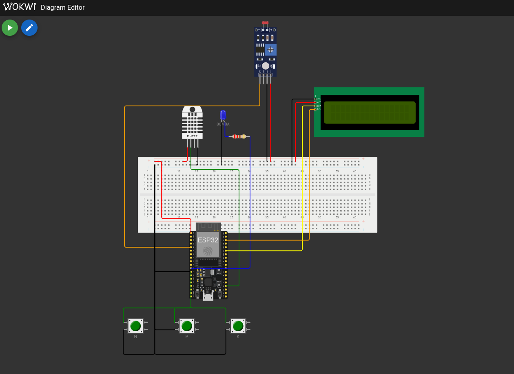

# Fase 2 — IoT e irrigação automática (ESP32)

Pasta: [`fase2/`](../../fase2/) · Vídeo da entrega original: <https://youtu.be/OJY5Zrz-Gng>

## O que faz

ESP32 simulado no Wokwi que decide quando ligar a bomba de irrigação de uma lavoura de
**tomate**. Um script Python consulta a previsão do tempo e gera um código que ajusta a irrigação,
e um script R treina uma regressão logística da decisão de irrigar.



## Circuito

| Componente | Pino | Papel |
|---|---|---|
| DHT22 | GPIO 15 | Umidade (representa a umidade do solo) |
| LDR | GPIO 34 | Leitura analógica convertida em pH de 0 a 14 |
| Botões N, P e K | GPIO 12, 13 e 14 | Presença de nitrogênio, fósforo e potássio |
| LED "BOMBA" | GPIO 27 | Representa o relé da bomba |
| LCD 16×2 (I2C) | SDA/SCL | Mostra as leituras e o estado da bomba |

## Regra de irrigação (`src/farmTech.ino`)

A bomba **liga** quando:

1. a umidade está abaixo de **60%**; **ou**
2. o pH está fora de **6,0 a 6,8** **e** falta algum dos nutrientes N, P ou K.

## Previsão do tempo (`src/main.py`)

Consulta a Open-Meteo (sem chave de API) para as próximas 24 h e devolve um código de uma letra,
digitado no Monitor Serial do ESP32:

| Código | Condição | Efeito na irrigação |
|---|---|---|
| `C` | chuva total ≥ 10 mm, pico ≥ 4 mm/h ou probabilidade máxima ≥ 80% | Suspende |
| `L` | chuva total ≥ 2 mm ou probabilidade média ≥ 40% | Reduz |
| `S` | demais casos | Normal |

## Regressão logística (`src/irrigacao.r`)

Treina um modelo logístico (`irrigar ~ umidade + ph + npk_count + chuva_mm`) sobre uma tabela de
exemplos escrita no próprio script e salva o gráfico da decisão em `analise_r/grafico_decisao.png`.

## Como executar

```bash
cd fase2
uv run python src/main.py     # código S/L/C para o ESP32
mkdir -p analise_r && Rscript src/irrigacao.r
```

Para o ESP32: abrir `fase2/` no VS Code com as extensões PlatformIO e Wokwi, compilar e iniciar a
simulação (`diagram.json` e `wokwi.toml` já estão na pasta).
