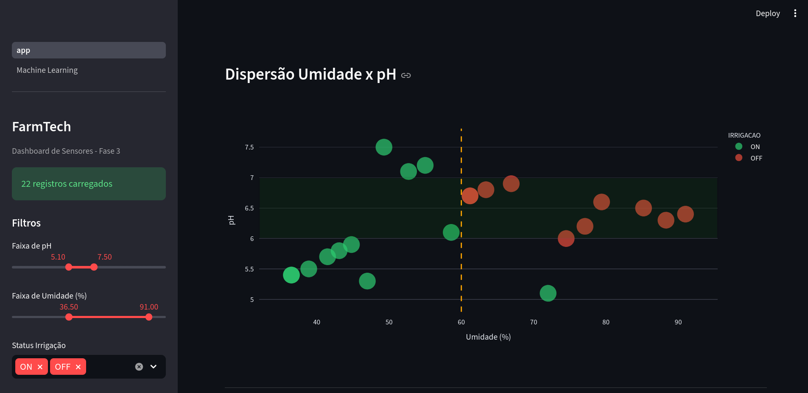
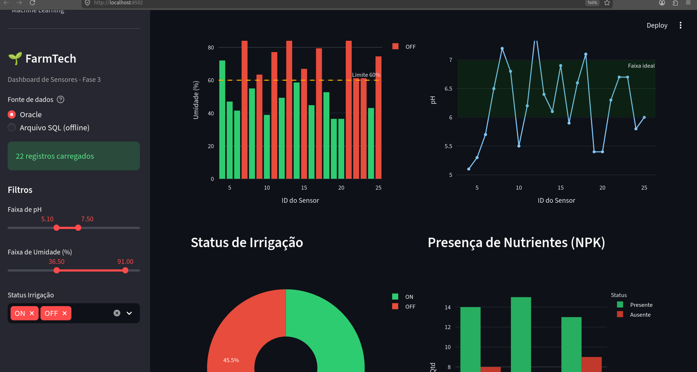
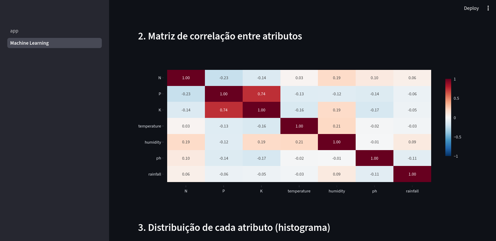

# Fase 3 — Banco de dados estruturado (Oracle)

Pasta: [`fase3/`](../../fase3/) · Vídeo da entrega original: <https://youtube.com/shorts/04vSbz1nAog>

## O que faz

Carrega no **Oracle da FIAP** as leituras dos sensores da Fase 2 (umidade, pH, N/P/K e estado da
irrigação), consulta esses dados com SQL e os exibe numa dashboard Streamlit. Uma segunda página
aplica Machine Learning para recomendar a cultura ideal.

## Tabela `SENSOR_DADOS`

| Coluna | Tipo | Descrição |
|---|---|---|
| `ID` | `NUMBER` (identity) | Identificador |
| `UMIDADE` | `NUMBER(5,1)` | Umidade do solo (%) |
| `PH` | `NUMBER(4,1)` | pH do solo (0 a 14) |
| `NITROGENIO`, `FOSFORO`, `POTASSIO` | `VARCHAR2(1)` | Presença do nutriente: `S` ou `N` |
| `IRRIGACAO` | `VARCHAR2(3)` | Estado da bomba: `ON` ou `OFF` |

| Script | O que faz |
|---|---|
| `create_table.sql` | Cria a tabela |
| `insert_dados.sql` | Insere os 20 registros simulados a partir da Fase 2 |
| `consulta.sql` | Todos os registros, irrigação ligada, médias de umidade e pH, pH fora de 6,0–7,0 e contagem por estado da irrigação |

## Dashboard (`dashboard/`)

- **Página de sensores (`app.py`):** indicadores (total, umidade média, pH médio, irrigação
  ON/OFF), gráficos de umidade com o limite de 60%, pH com a faixa ideal, N/P/K, dispersão
  umidade × pH, filtros e exportação em CSV. Se o Oracle estiver fora do ar, lê os dados de
  `insert_dados.sql`.
- **Página de ML (`pages/1_Machine_Learning.py`):** usa `produtos_agricolas.csv` (2.200 amostras,
  22 culturas; N, P, K, temperatura, umidade, pH e chuva). Traz análise exploratória, perfil ideal
  por cultura, seis modelos comparados e predição interativa.

Resultado da entrega original (divisão 80/20 estratificada):

| Modelo | Acurácia | F1 (macro) | Validação cruzada (5 folds) |
|---|---:|---:|---:|
| Random Forest | 0,9955 | 0,9955 | 0,9945 |
| Naive Bayes | 0,9955 | 0,9954 | 0,9950 |
| Gradient Boosting | 0,9886 | 0,9887 | 0,9909 |
| Decision Tree | 0,9795 | 0,9794 | 0,9868 |
| KNN (k = 5) | 0,9795 | 0,9793 | 0,9714 |
| Logistic Regression | 0,9727 | 0,9725 | 0,9714 |





## Como executar

As credenciais do Oracle vêm do `.env` único da raiz (ver [`.env.example`](../../.env.example)).

```bash
cd fase3/dashboard
uv run streamlit run app.py --server.port 8502
```

Os scripts SQL rodam no Oracle SQL Developer (host `oracle.fiap.com.br`, porta 1521, SID `ORCL`).
