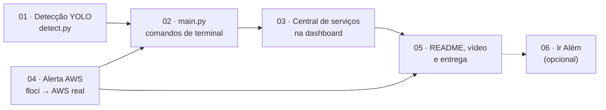

# Plano de entrega — Fase 7: A consolidação de um sistema

Tudo o que falta para entregar a Fase 7, organizado por frente de trabalho. Cada arquivo desta
pasta traz o objetivo, as tarefas, as decisões e o critério de pronto da sua frente.

## O que o enunciado pede, em resumo

- **Parte 1 — Sistema integrado (3 pts):** os programas das Fases **1, 2, 3 e 6** numa pasta
  única, um por subpasta, e a **dashboard da Fase 4** evoluída para disparar cada serviço por
  **botão** ou **comando de terminal**.
- **Parte 2 — Alerta na AWS (3 pts):** um serviço de mensageria na AWS que monitora os sensores
  (Fases 1 ou 2) **ou** os resultados do YOLO (Fase 6) e envia **e-mail ou SMS** com o alerta e a
  **ação corretiva**. Prints do console da AWS comentados no README.
- **Documentação, organização e vídeo (4 pts):** README integrado das Fases 1 a 6 com nome completo
  e RM dos integrantes; código organizado por fase; vídeo de até 10 min, não listado, no YouTube.
- **Entrega:** um `.txt` no Portal do Aluno com o link do repositório (privado, compartilhado com
  `fiap-tutoria`) e o link do vídeo. Nada pode mudar no repositório depois da entrega.
- **Ir Além (opcional):** AWS Rekognition e algoritmo genético, na pasta `IR-ALEM/`.

## Situação por critério de avaliação

| # | Critério | Peso | Frente | Situação |
|---|---|---|---|---|
| 5 | Sistema integrado e dashboard | 3,0 | [01](01-fase6-deteccao.md), [02](02-cli-main.md), [03](03-dashboard-central.md) | ✅ 01, 02 e 03 prontas: detecção, `main.py` e Central de serviços na dashboard |
| 6 | Alertas na AWS | 3,0 | [04](04-alerta-aws.md) | ✅ publicado na AWS real, com e-mail recebido e prints comentados no README |
| 2 | README | 1,0 | [05](05-documentacao-video-entrega.md) | 🟨 falta só o nome completo dos integrantes |
| 3 | Organização e boas práticas | 1,0 | todas | 🟨 pastas saneadas; falta o código novo |
| 4 | Vídeo | 1,0 | [05](05-documentacao-video-entrega.md) | ✅ publicado como não listado |
| 1 | Entrega, repositório e prazo | 1,0 | [05](05-documentacao-video-entrega.md) | ⬜ |
| 7 | Equipe de 4 a 5 integrantes | +1,0 | [05](05-documentacao-video-entrega.md) | conferir a lista final de integrantes |
| — | Ir Além 1 e 2 | opcional | [06](06-ir-alem.md) | ✅ os dois com vídeo; faltam só os prints do Ir Além 1 |

## Já feito (08/11/2026)

- [x] Entregas das Fases 1 a 6 reunidas em `fase1/` … `fase6/`.
- [x] Repositório Git aninhado da Fase 1 removido; AgriShield (`globalSolutions/`) retirado.
- [x] Pastas das fases saneadas: READMEs, modelos de template e arquivos sem uso removidos; o que
      era útil foi para [`docs/fases/`](../fases/) e [`docs/imagens/`](../imagens/).
- [x] `.env` único na raiz, com as variáveis `ORACLE_*` para as Fases 3 e 4.
- [x] Conexão com o Oracle da FIAP testada: `SENSOR_DADOS` (Fase 3) e `SOIL_DATA` (Fase 4) existem.
- [x] `fase6/models/best.pt` recuperado do Google Drive e conferido (classes trator e vaca).
- [x] README da raiz estruturado como documentação integrada.
- [x] **Frente 01 concluída:** `fase6/src/detect.py` detecta trator e vaca a partir do `best.pt`,
      com amostras em `fase6/data/amostras/` e ambiente leve (PyTorch para CPU).
- [x] **Frente 02 concluída:** `main.py` na raiz dispara os 12 serviços pelo terminal;
      `fase1/src/calculo.py` (Fase 1 sem perguntas) e `fase3/consultas.py` (SQL da Fase 3 no terminal).
- [x] **Frente 03 concluída:** dashboard central (`fase4/src/app.py`) com Início, Análise de solo e
      Central de serviços; cada fase dispara por botão via `main.py`.
- [x] **Frente 04, parte local:** `alerta/` com regras testadas, publicação no SNS (boto3), controle de
      repetição, botão na dashboard e floci preparado. Falta só a AWS real (passo a passo na frente 04).

## Ordem de execução

1. **[01 — Detecção com o YOLO](01-fase6-deteccao.md):** ✅ feita em 08/11/2026.
2. **[04 — Alerta na AWS](04-alerta-aws.md):** 🟨 código e floci prontos em 08/11/2026; falta a
   AWS real (conta do aluno), com passo a passo no arquivo.
3. **[02 — Comandos de terminal (`main.py`)](02-cli-main.md):** ✅ feita em 08/11/2026.
4. **[03 — Central de serviços na dashboard](03-dashboard-central.md):** ✅ feita em 08/11/2026.
5. **[05 — Documentação, vídeo e entrega](05-documentacao-video-entrega.md):** fecha a entrega.
6. **[06 — Ir Além](06-ir-alem.md):** Ir Além 2 feito em 09/11/2026; Ir Além 1 só com a conta AWS.

## Definição de pronto da entrega

- [x] Cada serviço das Fases 1, 2, 3 e 6 dispara por um botão **e** por um comando do `main.py`.
- [x] Um e-mail de alerta real, com problema e ação corretiva, chega a partir de uma leitura de sensor.
- [x] Prints do console da AWS em `docs/imagens/aws/`, comentados no README.
- [ ] README com nomes completos, RMs, instruções que funcionam num clone novo e link do vídeo.
- [x] Vídeo de até 10 min publicado como não listado.
- [ ] Branch `feature/entrega-cap-1-fase7` integrada na `main`; repositório privado e compartilhado
      com `fiap-tutoria`.
- [ ] `.txt` enviado no portal **antes** do prazo; nenhum commit depois do envio.
